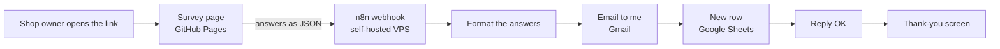

# Shop Survey

A mobile-first survey for African food shop owners in the UK. Each response is processed automatically by an n8n workflow: I get an email and the answers are added to a Google Sheet, with no copying and pasting.

**Live survey:** https://abiodunogunleye.github.io/shop-survey/

## Why I built it

I'm researching which everyday problems cost African food shops the most time and money, before building a product for them. Long questionnaires sent over WhatsApp rarely get finished, so I made one that a busy shop owner can complete in about 3 minutes, mostly by tapping.

I chose to build it myself rather than use Google Forms or Tally. That way I control the design, the data goes only where I send it, and the consent rules work the way I need them to.

## How it works

1. The owner answers 14 questions, one per screen.
2. The page sends the answers to an n8n webhook.
3. n8n formats the answers, emails them to me, and adds a row to a Google Sheet.
4. The page shows a thank-you screen only after n8n confirms the answers arrived. If sending fails, the owner sees a "try again" button, so no answers are lost silently.

## What the survey covers

| Area | What it asks about |
| --- | --- |
| Customers and orders | WhatsApp and phone enquiries, missed replies, delivery, party and event orders |
| Stock and suppliers | Running out of stock, wasted stock, supplier problems |
| Loyal customers | Customer lists, how regulars are rewarded, interest in a loyalty scheme |
| Running the shop | Hours spent on admin, the two biggest problems, the one thing to fix, a fair monthly price |

## Features

- One question per screen, with large tap targets and automatic progression
- Progress bar and a back button
- Multi-select questions with limits ("pick up to two")
- Optional contact step: name and number become required only when the owner asks for a call or the summary
- A hidden spam trap for bots
- Preview mode: if the webhook URL isn't set, the page works but sends nothing
- Keyboard and screen-reader friendly, and respects reduced-motion settings
- A single self-contained HTML file with no frameworks or build step

## Privacy (UK GDPR)

- **No pre-ticked consent boxes.** Contact is opt-in only.
- **Data minimisation.** Only a name and a number are required, and only from owners who ask to be contacted. Everyone else can stay anonymous.
- **A clear privacy notice** on the last screen: who is collecting the data, why, where it's stored, how long it's kept (deleted within 12 months), and the owner's rights, including complaining to the ICO.
- **No third-party tracking.** The font is embedded in the page, so visitors' details aren't sent to Google Fonts. The only outgoing request is the one that submits the answers.
- **Responses are stored privately** and never shared or sold.

## Tech stack

| Part | Tool |
| --- | --- |
| Survey page | HTML, CSS, vanilla JavaScript |
| Hosting | GitHub Pages |
| Automation | n8n (self-hosted on a VPS behind HTTPS) |
| Notifications | Gmail |
| Storage | Google Sheets |
| Testing | Playwright (automated click-through on phone and desktop sizes) |
| Built with | Claude |

## Reusing it for another business

The page is a template. To adapt it:

1. Edit the `QUESTIONS` list in `index.html` with the new questions.
2. Change the colours in the `:root` section of the CSS.
3. Point `webhookUrl` in `SURVEY_CONFIG` at your own n8n webhook.
4. Update the privacy notice to match how you'll use the data.

The same pattern works for customer feedback, booking enquiries, client intake forms and similar.

## Author

**Abiodun Ogunleye**, AI automation engineer, UK.
[GitHub](https://github.com/abiodunogunleye)
